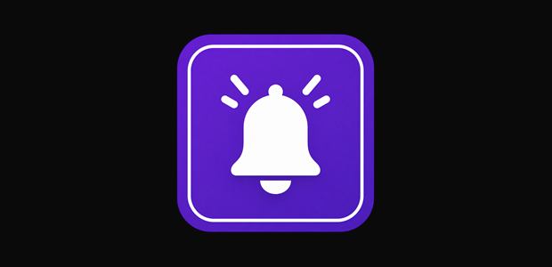

<div align="center">
  
  

  <h1>NotiGlow</h1>

  <p><strong>Transform your Windows notifications into sleek, ambient fullscreen edge glow animations.</strong></p>

  <p>
    <a href="https://apps.microsoft.com/detail/9P9L33HG5V64" target="_blank">
      
    </a>
    &nbsp;&nbsp;
    <a href="https://github.com/owergungor/Notiglow/releases" target="_blank">
      
    </a>

  </p>

  <p>
    A lightweight, open-source ambient notification utility engineered for Windows 10 & 11 with Fluent Design aesthetics, deep customization, and a strict local-first privacy architecture.
  </p>

  <p>
    
    
    
    
    
  </p>

</div>

---

## 🌟 Overview

Standard Windows toast notifications can be abrupt, distracting, and easily missed during immersive gameplay, video playback, or deep focus workflows.

**NotiGlow** replaces that friction with an elegant, peripheral screen-edge glow. Whenever a notification arrives from your favorite apps—such as Discord, WhatsApp, Slack, Outlook, or Steam—NotiGlow illuminates the perimeter of your screen with smooth, customizable light effects, matching each application’s distinct color identity.

- 🪟 **Native Fluent Experience**: Designed to feel right at home on modern Windows 11 and Windows 10 with acrylic blur, rounded corners, and smooth cubic animations.
- 🔒 **Local-First & Private**: Evaluates notification events strictly in volatile local RAM; zero telemetry, zero analytics, zero cloud transmission.
- ⚡ **Lightweight & High-Performance**: Optimized background listener with minimal idle CPU and RAM footprint.

---

## 📸 Screenshots & Preview

<div align="center">
  
  
  
  <br/><br/>
  
  <p><em>Immersive ambient lighting with customizable border thickness, glow blur, and fluid animation physics.</em></p>
</div>

---

## ✨ Features

### 🌈 Customizable Edge Glow
- **Border Geometry**: Fine-tune edge thickness (1 px – 40 px), glow blur radius (5 px – 100 px), and opacity intensity (10% – 100%).
- **Duration Control**: Configure illumination duration from quick 500 ms flashes up to sustained 15-second ambient glows.
- **Multi-Monitor Flexibility**: Render edge glows on your **Active Monitor** (where your mouse is focused), your **Primary Monitor**, or across **All Connected Displays**.
- **Burst Handling**: Choose how rapid back-to-back notifications behave: *Restart* the animation, *Extend* duration, *Queue* sequentially, or *Ignore* spam.

### 🎨 Color Palette & Themes
- **12 Curated Presets**: Switch instantly between *Standard, Zen, Amber, Mocha, Burgundy, Sakura, Bubblegum, Amethyst, Violet, Indigo, Sapphire*, and *Nature*.
- **Custom Color Picker**: Interactive HSV saturation/value spectrum with continuous drag selection and manual RGB/Hex input.
- **Theme Modes**: Seamlessly toggle between **Dark**, **Light**, **System Sync**, or the translucent **Liquid Glass** aesthetic.

### 💫 Animation Styles
NotiGlow features five distinct animation profiles engineered with hardware-accelerated WPF storyboards:
- **Pulse**: Gentle breathing glow with soothing cubic ease-in-out curve.
- **Sweep**: Fluid neon beam racing around your display bezels.
- **Ambient**: Subtle, uniform perimeter glow for non-disruptive awareness.
- **Comet**: Dynamic tracer with a trailing tail navigating screen edges.
- **Ripple**: Wave-like propagation that spreads outward from screen corners.

### 📱 Tracked Applications & Profiles
- **App Detection**: Automatically identifies applications via Windows AppUserModelId (AUMID) or process executable path.
- **Per-App Customization**: Assign dedicated colors, animation styles, notification priorities (*Low*, *Normal*, *High*), and duration overrides for individual apps.
- **Profile Management**: Instant search, alphabetical/chronological sorting, and one-click enable/disable toggles.

### 🎮 Gaming Mode & Detection
- **Game Discovery**: Automatically scans Steam libraries and Epic Games manifests to recognize installed titles.
- **Unified Gaming Settings**: Apply shared duration, intensity, and blur scaling across all games simultaneously, or define per-game overrides.
- **Dual View Layouts**: Organize your tracked gaming library with either a compact **List View** or an expansive **Grid View**.
- **Fullscreen Respect**: Automatically suppresses or softens visual effects during competitive gameplay.

### 🌍 Global Localization
Dynamically switch between 5 fully supported languages with 100% key parity and instant in-memory re-rendering:
- 🇬🇧 English (`en-US`)
- 🇪🇸 Español (`es-ES`)
- 🇫🇷 Français (`fr-FR`)
- 🇩🇪 Deutsch (`de-DE`)
- 🇹🇷 Türkçe (`tr-TR`)

---

## 📥 Download & Installation

Choose your preferred distribution method:

| Method | Best For | Description | Link |
| :--- | :--- | :--- | :--- |
| **Microsoft Store** | Recommended | Automated updates, verified sandbox, zero configuration | [**Get from Store**](https://apps.microsoft.com/detail/9P9L33HG5V64) |
| **Setup Installer** | Standalone Desktop | Standard Windows installer with desktop icon & auto-start option | [**Download EXE**](https://github.com/owergungor/Notiglow/releases) |
| **Portable ZIP** | No Installation | Extract and run directly without administrative privileges | [**Download ZIP**](https://github.com/owergungor/Notiglow/releases) |

### 🛍️ Option 1: Microsoft Store (Recommended)

Install NotiGlow directly from the official Microsoft Store for verified security, sandboxed execution, and seamless automatic updates:

<a href="https://apps.microsoft.com/detail/9P9L33HG5V64" target="_blank">
  
</a>

- **Store Page**: [https://apps.microsoft.com/detail/9P9L33HG5V64](https://apps.microsoft.com/detail/9P9L33HG5V64)
- **Package Identity**: `crius.Notiglow` (Store ID: `9P9L33HG5V64`)

### 📦 Option 2: Standalone Setup (GitHub Releases)

For standard desktop installation with an integrated updater and desktop/autostart options:

1. Navigate to [NotiGlow Releases](https://github.com/owergungor/Notiglow/releases).
2. Download the latest installer (`NotiGlow-Setup-vX.X.exe`).
3. Run the installer and launch NotiGlow from your Start Menu or system tray.

### 💼 Option 3: Portable Archive

1. Download `NotiGlow_win-x64.zip` from [Releases](https://github.com/owergungor/Notiglow/releases).
2. Extract the archive to any folder and launch `NotiGlow.exe`.

---

## 💻 System Requirements

- **Operating System**: Windows 10 (version 1809 / build 17763 or higher) or Windows 11
- **Architecture**: 64-bit (x64)
- **Runtime**: Self-contained (no separate .NET runtime installation required)
- **Permissions**: Requires Windows Notification Listener permission (`UserNotificationListener`) to read toast sender headers.

---

## 🛡️ Privacy & Security (Local-First)

NotiGlow is architected from the ground up to respect your privacy:

- **100% Local In-Memory Processing**: When Windows receives a toast notification, NotiGlow inspects the sender application identifier and header in volatile RAM solely to trigger the associated color animation.
- **No Data Retention**: Message bodies, sender names, and notification contents are **never written to disk**, never logged, and never transmitted over the network.
- **Zero Telemetry**: No third-party analytics SDKs, tracking pixels, or remote crash reporting tools.
- **Offline Operation**:
  - The **Microsoft Store edition** is completely offline with zero outbound network calls.
  - The **GitHub edition** only queries the public GitHub Releases API (`api.github.com`) to check for software updates if enabled in settings.

📄 Read our full [Privacy Policy](https://owergungor.github.io/Notiglow/privacy-policy.html).

---

## 🛠️ Technologies

- **Language**: [C# 13](https://learn.microsoft.com/dotnet/csharp/)
- **Runtime**: [.NET 9.0](https://dotnet.microsoft.com/) (`net9.0-windows10.0.19041.0`)
- **UI Framework**: [WPF (Windows Presentation Foundation)](https://learn.microsoft.com/dotnet/desktop/wpf/)
- **UI Styling**: [WPF-UI](https://github.com/lepoco/wpfui) (Fluent Design System)
- **APIs**: Windows Runtime (WinRT) `Windows.UI.Notifications.Management.UserNotificationListener`
- **Packaging**: MSIX (Microsoft Store) & Inno Setup 6 (Standalone Installer)

---

## 🧑‍💻 Building from Source

To compile and run NotiGlow locally:

### Prerequisites
- [.NET 9.0 SDK](https://dotnet.microsoft.com/download/dotnet/9.0)
- Visual Studio 2022 (v17.12+) or Visual Studio Code with the C# Dev Kit
- Windows 10/11 x64

### Build & Run
```powershell
# 1. Clone repository
git clone https://github.com/owergungor/Notiglow.git
cd Notiglow

# 2. Restore dependencies and build
dotnet build NotiGlow.sln -c Release

# 3. Run unit tests
dotnet test NotiGlow.sln -c Release

# 4. Launch NotiGlow
dotnet run --project NotiGlow.csproj -c Release
```

---

## 📄 License & Credits

- Distributed under the [MIT License](LICENSE).
- Developed by **crius** / [owergungor](https://github.com/owergungor).
- For questions, feedback, or feature suggestions, feel free to open an [Issue](https://github.com/owergungor/Notiglow/issues) or submit a Pull Request.

<div align="center">
  <sub>Built with ❤️ for Windows enthusiasts. &bull; <a href="https://apps.microsoft.com/detail/9P9L33HG5V64">Microsoft Store</a> &bull; <a href="https://github.com/owergungor/Notiglow/releases">GitHub Releases</a> &bull; <a href="https://owergungor.github.io/Notiglow/privacy-policy.html">Privacy Policy</a></sub>
</div>
