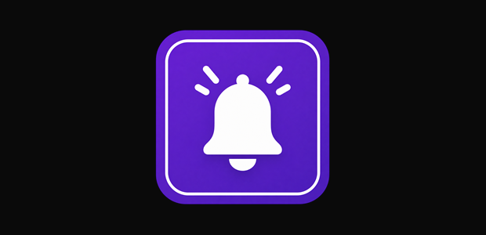

<div align="center">

  

  <h1>NotiGlow v4.0</h1>

  <p><strong>Transform your Windows notifications into sleek, ambient fullscreen edge glow animations — now rebuilt natively with WinUI 3 and Windows 11 Fluent Design.</strong></p>

  <p>
    <a href="https://apps.microsoft.com/detail/9P9L33HG5V64" target="_blank">
      
    </a>
    &nbsp;&nbsp;
    <a href="https://github.com/owergungor/Notiglow/releases/tag/v4.0" target="_blank">
      
    </a>
  </p>

  <p>
    
    
    
    
    
    
  </p>

</div>

---

## What Is NotiGlow?

Standard Windows toast notifications are easy to miss during immersive gameplay, full-screen video playback, or focused work — or too intrusive when they pop over active content.

**NotiGlow** listens to incoming Windows notifications locally and illuminates the perimeter of your display with smooth, hardware-accelerated ambient edge glow animations tailored to each application's color and style.

Starting with **v4.0**, NotiGlow has been completely migrated from WPF to **WinUI 3 + Windows App SDK 1.6**, delivering a genuine Windows 11 Settings-inspired experience with native Fluent controls, backdrop materials, and improved visual polish.

---

## Preview

<div align="center">
  
  <br/><br/>
  
  <p><em>Customizable ambient screen-edge glow with real-time live preview and per-app color profiles.</em></p>
</div>

---

## Core Features

### Ambient Edge Glow & Animation Styles
- **Five Animation Styles**:
  - **Pulse** — Gentle breathing illumination with smooth easing.
  - **Sweep** — Fluid light beam traveling around your screen edges.
  - **Comet** — Travelling bright head with a fading trail.
  - **Ripple** — Expanding wave propagation around the screen perimeter.
  - **Ambient** — Steady, soft border glow for minimal distraction.
- **Fine-Grained Geometry & Timing**:
  - Adjust **Duration** (`500 ms` – `15 s`), **Intensity** (`10%` – `100%`), **Border Thickness**, **Glow Size** (`0 px` – `256 px`), and **Corner Radius** (`0 px` – `48 px`).
- **Multi-Monitor Support**: Display edge glows on the **Active Monitor** (following cursor/focus), **Primary Monitor**, or **All Monitors**.
- **Notification Burst Handling**: Choose how rapid notifications behave — **Restart**, **Extend**, **Queue**, or **Ignore**.
- **Accessibility & Display Safety**: Supports **OLED Screen Saver Mode**, **Subtle Glow Mode**, and respects **Reduce Motion / Reduce Animations** preferences.

### Supported Game Platforms & App Detection
- **Game Platform Discovery**:
  - **Steam** — Scans local Steam library folders (`libraryfolders.vdf` and `appmanifest_*.acf`) to discover installed titles.
  - **Epic Games** — Reads local Epic Games Launcher manifests (`%ProgramData%\Epic\EpicGamesLauncher\Data\Manifests`) to identify installed games.
  - **Manual Addition** — Add any game or desktop executable directly via file selection (`.exe`) or App ID.
- **Installed Application Detection**:
  - Scans standard Windows installed application entries (Registry Uninstall keys, App Paths, Start Menu shortcuts, and common built-in desktop apps such as Discord, WhatsApp, Telegram, Teams, Spotify, Slack, and Steam) to populate profiles automatically.
  - Matches incoming Windows notifications by AppUserModelId (AUMID), executable name, or display name.

### Applications & Gaming Management
- **Applications (Streamlined List View)**:
  - Clean, Windows 11 Settings-style horizontal list cards displaying each app's icon, name, duration, intensity, animation style, priority, color swatch, quick preview, edit, delete, and native enable/disable toggle.
  - Alphabetical and Recently Added sorting, one-click **Scan Installed Apps**, and **Add App**.
- **Gaming Mode**:
  - Detects when tracked games are running and applies configurable in-game behavior rules: **Glow During Games**, **Dim Intensity in Games**, **Shorten Duration in Games**, and **High Priority Only**.
  - Compact game cards with iconized **Customize** (pencil) and **Remove** (trash with destructive red hover) buttons, plus a native Windows 11 modal `ContentDialog` confirmation before removing a game.
- **Automatic Category Routing**:
  - Every profile belongs strictly to either **General App** (`Applications` tab) or **Gaming** (`Gaming` tab).
  - Changing a profile's category immediately moves it to the target tab without losing any color, animation, or timing settings, navigates to that tab, scrolls the item into view, and highlights it.

### Unified Profile & Game Customization
- Both **Applications** and **Gaming** share the same reusable WinUI 3 `ProfileEditorControl`:
  - **Color Picker**: Curated preset palette, custom HSV/Hex color selector, and dynamic **RGB Spectrum** mode.
  - **Live Preview**: Real-time `EdgePreviewControl` showing your exact color, corner radius, intensity, and animation style before saving.
  - **Per-Game Custom Glow Toggle**: Enable or disable custom per-game overrides to either use game-specific glow settings or inherit global Gaming Mode rules.

### Windows 11 Fluent Design (WinUI 3) & Themes
- **Native WinUI 3 Architecture**: Built with `NavigationView`, native `ToggleSwitch`, `ContentDialog`, `ComboBox`, `Slider`, and `EntranceThemeTransition`.
- **Window Backdrop Materials**: Switch seamlessly between **Acrylic**, **Mica**, and **Mica Alt**.
- **Themes & Accent Colors**: Supports **System**, **Light**, and **Dark** theme modes, defaulting to the **Windows System Accent** with curated accent color presets.
- **5 Languages**: Instant in-app switching across **English (`en-US`)**, **Español (`es-ES`)**, **Français (`fr-FR`)**, **Deutsch (`de-DE`)**, and **Türkçe (`tr-TR`)**.

---

## System Requirements

- **Operating System**: Windows 10 (version 1809 / build `17763` or newer) or Windows 11
- **Architecture**: 64-bit (`x64`)
- **Permissions**: Windows Notification Listener access (`UserNotificationListener`) to detect incoming toast notification headers
- **Runtime Dependencies**: **None required for end users** — NotiGlow v4.0 is distributed as a **self-contained** package bundling both **.NET 9.0** and **Windows App SDK 1.6** (`WindowsAppSDKSelfContained=true`).

---

## Download, Installation & Updating

### Direct MSIX Package (v4.0)
- **Download MSIX (x64)**: [**NotiGlow-v4.0-x64.msix**](https://github.com/owergungor/Notiglow/releases/download/v4.0/NotiGlow-v4.0-x64.msix)
- **All Release Assets**: [GitHub Releases — v4.0](https://github.com/owergungor/Notiglow/releases/tag/v4.0)
- **Microsoft Store**: [NotiGlow on Microsoft Store](https://apps.microsoft.com/detail/9P9L33HG5V64) (Package Identity: `crius.Notiglow`)

### Installing or Updating via MSIX
1. Download `NotiGlow-v4.0-x64.msix` from the [v4.0 Release page](https://github.com/owergungor/Notiglow/releases/tag/v4.0).
2. Double-click the `.msix` file to open Windows App Installer and click **Install** (or **Update** if a previous `crius.Notiglow` MSIX version is already installed — the package identity and publisher remain unchanged for in-place upgrades).
3. Launch **NotiGlow** from the Start Menu and grant Windows Notification access when prompted.

> **Note on Sideloading**: MSIX packages downloaded directly from GitHub are signed with the project's self-signed publisher certificate (`CN=2F9A5694-FADC-405A-AF51-BB9269D3FFF1`). If Windows App Installer asks to trust the certificate during manual sideloading, import the certificate into *Local Machine → Trusted People* or install via the Microsoft Store / standalone release builds.

### Standalone Setup / Portable ZIP
1. Download `NotiGlow-Setup-v4.0.exe` or `NotiGlow_4.0_win-x64.zip` from [GitHub Releases](https://github.com/owergungor/Notiglow/releases/tag/v4.0).
2. Run the setup installer or extract the ZIP archive and launch `NotiGlow.exe`.
3. Your existing `%AppData%\NotiGlow\settings.json` and `profiles.json` are preserved automatically across updates (including automatic migration of legacy view settings).

---

## Building from Source

### Prerequisites
- Windows 10/11 (x64)
- [.NET 9.0 SDK](https://dotnet.microsoft.com/download/dotnet/9.0)
- Windows 10/11 SDK (`10.0.19041.0` or newer; `Microsoft.WindowsAppSDK 1.6` is restored automatically via NuGet)

### Commands
```powershell
# Clone the repository
git clone https://github.com/owergungor/Notiglow.git
cd Notiglow

# Build Debug / Release
dotnet build NotiGlow.sln -c Release

# Run the full test suite
dotnet test NotiGlow.sln -c Release

# Build self-contained x64 MSIX package
powershell -ExecutionPolicy Bypass -File Tools\build-msix.ps1
```

---

## Privacy Policy

NotiGlow processes incoming notification headers strictly in local memory and stores all settings and profiles locally on your device. There is no telemetry, no analytics, no advertising, and no user account system.

Read the full Privacy Policy here:  
**[https://owergungor.github.io/Notiglow/privacy-policy.html](https://owergungor.github.io/Notiglow/privacy-policy.html)**

---

## License & Contributing

- **License**: Distributed under the [MIT License](LICENSE).
- **Contributing**: Bug reports, feature suggestions, and pull requests are welcome. Please review [CONTRIBUTING.md](CONTRIBUTING.md) and open an issue on [GitHub Issues](https://github.com/owergungor/Notiglow/issues).

<div align="center">
  <sub>NotiGlow v4.0 &bull; <a href="https://github.com/owergungor/Notiglow/releases/tag/v4.0">Releases</a> &bull; <a href="https://owergungor.github.io/Notiglow/privacy-policy.html">Privacy Policy</a> &bull; <a href="LICENSE">MIT License</a></sub>
</div>
